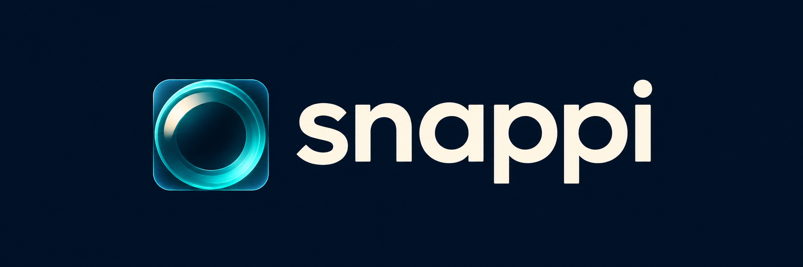

<p align="center"></p>

# Snappi

**An open-source iPhone camera for film-inspired photos and videos.**

Shoot, explore a look, and keep the moment. Snappi pairs six film-inspired treatments with tactile camera controls and a swipeable roll. Built with SwiftUI, AVFoundation and Core Image. Processing happens on your iPhone—no accounts, ads, subscriptions or cloud uploads.

[MIT license](LICENSE) · iOS 17+ · Swift · [Media checks](https://github.com/MphoCodes/Snappi/actions/workflows/checks.yml)

## What you can do

- Capture photos and videos with the front or rear wide camera.
- Select **Pair** and press the shutter twice to create one landscape half-frame photo. The first shot stays on the left while you frame the second on the right. Tap **Cancel** between shots to start over.
- Explore Original, Daylight, Golden, Faded, Noir and Tape with live previews. Swipe the viewfinder or tap the film strip to change looks.
- Tune effect strength, grain, warmth and camera exposure (−2 to +2 EV, clamped to device capabilities).
- Use photo flash/video torch, a 3/10-second timer, composition grid, date stamp and 1×/2×/3× digital zoom.
- Browse your roll full screen with swipe navigation, thumbnails, previous/next buttons and pinch/double-tap photo zoom.
- Tap the heart to favorite a capture, or use Select to organize several at once. Restore deleted captures from Recently Deleted.
- Import photos, play videos, share captures and optionally save to Apple Photos.
- Keep original captures alongside processed versions.
- Get haptic feedback, animated look selection, shutter feedback, recording progress and a saved-photo print animation. Decorative motion respects Reduce Motion.

Portrait video supports up to 1080p and 60 seconds per clip. Effects render after recording; keep Snappi open while processing finishes.

## Try it

This repository contains the source code. There is no public App Store release, TestFlight link or ready-to-install signed download yet. Making the source public does not remove Apple's iPhone signing requirements.

To build for an iPhone:

1. Clone this repository and open `Snappi.xcodeproj` in Xcode.
2. Select your own development team and a unique bundle identifier in the target's signing settings.
3. Connect your iPhone, complete pairing and Developer Mode setup, then build and run.

The project was built with Xcode 27.2 and uses its `project.xcproj` format. The deployment target is iOS 17 or later. Older Xcode releases may not open this project format.

For a command-line device build, replace the placeholders with your signing details:

```sh
xcodebuild -project Snappi.xcodeproj -scheme Snappi -configuration Debug \
  -destination 'generic/platform=iOS' \
  DEVELOPMENT_TEAM=YOUR_TEAM_ID \
  PRODUCT_BUNDLE_IDENTIFIER=com.yourname.snappi \
  -allowProvisioningUpdates build
```

Development installs require periodic signing renewal; the lifetime depends on your Apple account and provisioning profile. Update in place to preserve local captures rather than uninstalling.

## Simulator package

Download the [simulator developer preview](https://github.com/MphoCodes/Snappi/releases/tag/v1.1.0-preview.4), or build a zipped simulator app with Xcode 27.2 or later:

```sh
./scripts/package-simulator.sh
unzip -q dist/Snappi-simulator.zip -d dist
xcrun simctl install booted dist/Snappi.app
xcrun simctl launch booted com.mphocodes.snappi
```

The script produces `dist/Snappi-simulator.zip` and a SHA-256 checksum. This package is for the iOS Simulator on a Mac; it does not install on an iPhone or provide a real camera. Use photo import to explore the interface, and a physical device to verify camera and microphone behavior. An iPhone distribution still requires an appropriately signed build through Xcode, TestFlight or the App Store.

## Your photos stay yours

Camera permission is required for capture. Microphone permission is requested for video; without it, video is silent. Photos add-only permission is optional: captures stay in Snappi even if export is denied. There are no third-party services or analytics in the app.

Your Roll groups captures by day and filters photos, videos, favorites and Recently Deleted. Tap Select for bulk actions. Deleted captures stay in Recently Deleted until restored. Copies saved to Apple Photos are independent.

Deleting Snappi deletes its local library. Export any photos and videos you want to keep first. Original movie files are retained if effect processing fails; background export is not guaranteed.

The Original look bypasses preset colour treatment. Grain, warmth and date-stamp controls remain independent; turn them off for an untouched colour treatment. The live preview is downscaled and capped at 15 fps. Small film-strip previews refresh every two seconds; captured media is processed separately.

## Current limits

This is an early native camera app. Capture is portrait-only and uses the front/rear wide cameras with digital zoom. Manual ISO/shutter, physical lens selection, RAW/Live Photos, double exposure and video import are not implemented yet. The six looks are original treatments rather than calibrated reproductions of particular film stocks or cameras.

## Development and checks

GitHub Actions runs image and synthetic video checks on pushes and pull requests. It does not currently build the Xcode 27.2 project or exercise camera hardware. Run the same checks locally on macOS:

```sh
./Tests/run.sh
```

The checks cover preset output, Original identity with independent effects off, zero-strength behaviour, finite image extents, rendered video effects, portrait orientation, duration, source preservation and invalid-input errors.

Device and simulator builds passed during development. Photo/video capture, audio, Photos export, photo swipes, double-tap zoom/reset and saved-photo feedback have been reported working on a physical iPhone. Pinch gestures, video page-away audio and broader interruption/device coverage still need dedicated testing. macOS video-test compilation reports AVFoundation deprecation warnings for APIs retained for the iOS 17 deployment target.

| File | Responsibility |
| --- | --- |
| `Snappi/Effects.swift` | Shared Core Image treatments |
| `Snappi/VideoRenderer.swift` | Filtered video export |
| `Snappi/CameraCaptureService.swift` | AVFoundation hardware adapter |
| `Snappi/CameraViewModel.swift` | Main-actor capture, countdown and import workflows |
| `Snappi/MediaRepository.swift` | Injectable media storage and thumbnail reads |
| `Snappi/MediaProcessor.swift` | Actor-isolated photo/video processing |
| `Snappi/PhotoLibraryExporter.swift` | Photos permission and export |
| `Snappi/CameraPermissions.swift` | Injectable camera/microphone permission access |
| `Snappi/AppServices.swift` | Composition root for live dependencies |
| `Snappi/GalleryViewModel.swift` | Gallery export, listing and thumbnail state |
| `Snappi/SnappiApp.swift` | Camera screen and settings |
| `Snappi/CameraControls.swift` | Film previews, shutter and motion |
| `Snappi/GalleryScreen.swift` | Paged viewer, zoom and playback presentation |

See [Architecture](docs/ARCHITECTURE.md) for dependency boundaries, concurrency and persistence guarantees. With an iOS simulator booted, run `./Tests/run-architecture.sh` for workflow and storage failure checks. The hardware adapter retains a documented queue-confinement boundary; the refactor does not claim complete Swift 6 actor isolation for AVFoundation.

## Contributing

Issues and focused pull requests are welcome. Describe the device, iOS version, steps to reproduce and expected behaviour for bugs. Preserve original media on processing failures, keep processing on device, and respect Reduce Motion. Include relevant test results with changes to capture or rendering.

## License

Snappi is available under the [MIT license](LICENSE).

The Daylight artwork in `branding/` uses a turquoise lens, deep navy and a cream reflection. The raster artwork was AI-generated; earlier concepts are retained as design exploration.
