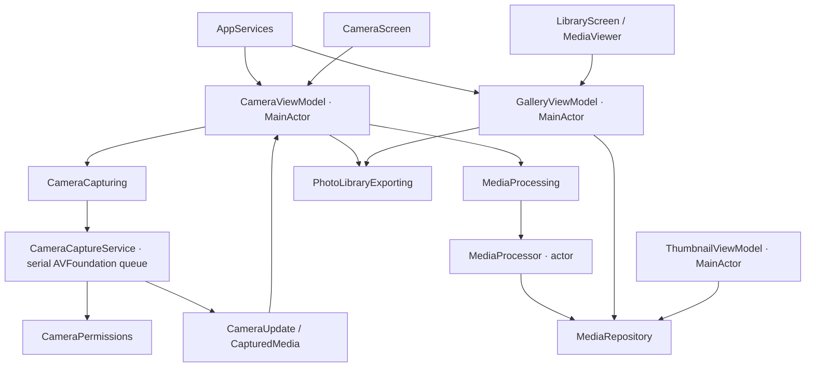

# Architecture

Snappi uses main-actor screen view models with injected service protocols. `AppServices` is the composition root; it chooses the live implementations and constructs view models. Views do not instantiate capture hardware or perform media persistence/export workflows.

## Ownership

- `CameraCaptureService` owns the session, device configuration, AVFoundation delegates, recording and throttled live previews. It emits immutable capture options and captured bytes/URLs. It has no file-store or Photos-export implementation.
- `CameraViewModel` owns observable camera state, countdown cancellation, photo import, processing/export coordination and the latest roll thumbnail. It reserves work synchronously before asynchronous permission/hardware operations.
- `MediaProcessor` is an actor that applies photo effects and coordinates `VideoRenderer`. It writes through `MediaRepository`, retaining originals until processed media has been saved successfully.
- `LocalMediaRepository` owns the existing `Documents/Captures` paths, atomic writes, removal, enumeration and thumbnail reads. A different directory or failing repository can be injected in tests.
- `PhotoLibraryExporter` owns Photos permission and export. Failure does not remove a successful local capture.
- `SystemCameraPermissions` owns camera/microphone permission access behind `CameraPermissions`.
- `GalleryViewModel` owns listing and export state; `ThumbnailViewModel` owns asynchronous thumbnail loading. AVPlayer and UIKit zoom remain presentation adapters with selection/background lifecycle hooks.
- SwiftUI retains transient presentation state (sheets, selection, animation) and AppStorage-backed user preferences. The view passes an effect-settings snapshot to its view model.

## Concurrency and cancellation

UI state is isolated to `@MainActor`; processing is actor-isolated. Complete Swift concurrency checking is enabled. `CameraCaptureService` is the one production `@unchecked Sendable` adapter because AVFoundation delegates and Dispatch queues are used for hardware access. It relies on explicit confinement: session/capture state on the capture queue, preview timing/context on the frame queue, effect options under a lock, and callbacks on the main actor. Do not access these values from arbitrary callers.

Device objects do not cross into UI update closures. Photo delegate bytes are extracted before queue handoff. Update closures are Sendable. Permission requests carry a generation ID, so a stale microphone response cannot start a recording after suspension. Countdown IDs prevent cancelled tasks from clearing a later countdown.

Captured-media deliveries are processed in order; a second delivery is not silently dropped. Only the last queued completion clears busy state and releases hardware. An in-flight durable save/export intentionally retains its view model until completion. Background video rendering is still not guaranteed by iOS.

## Persistence compatibility

No migration is required. `Documents/Captures`, `snappi-`/`original-` filenames and stored AppStorage keys remain unchanged. Updating the application in place preserves the library.

## Verification

- `./Tests/run.sh`: shared image effects and synthetic video rendering.
- With an iOS simulator booted, `./Tests/run-architecture.sh`: real temporary-file photo processing, countdown cancellation, synchronous workflow reservation, local save on export denial, unlock on processing failure, original retention after a failed final write, and queued failure followed by successful delivery. Set `SNAPPI_SIMULATOR_ID` to select a simulator explicitly.
- Xcode simulator and signed device builds check integration. Hardware permission dialogs, capture/audio and interruption behaviour still need direct physical-device verification after this refactor.
